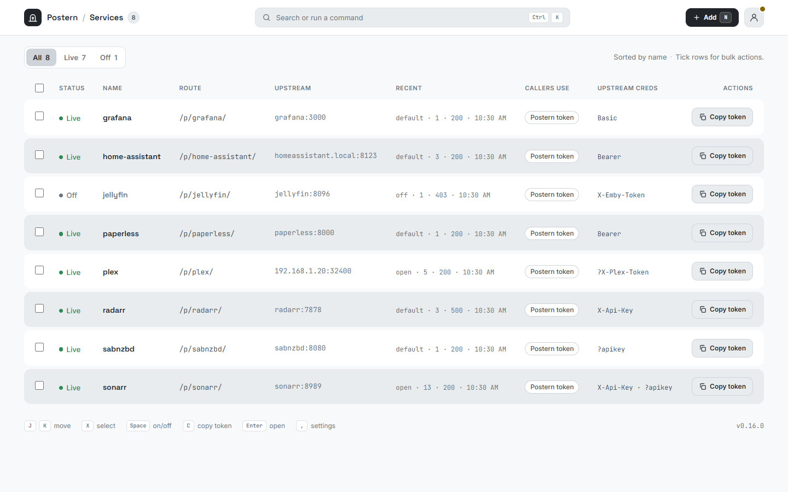
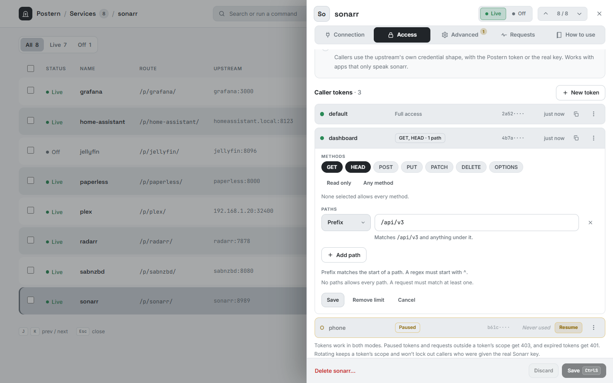
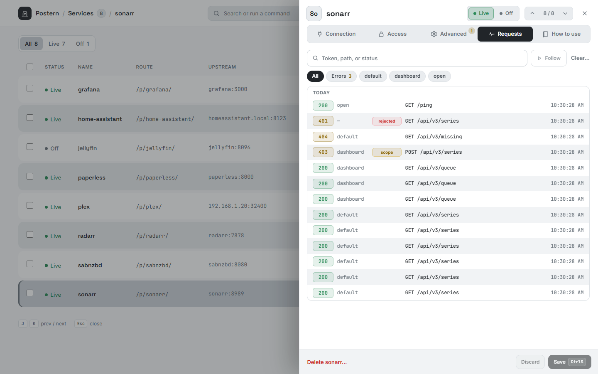
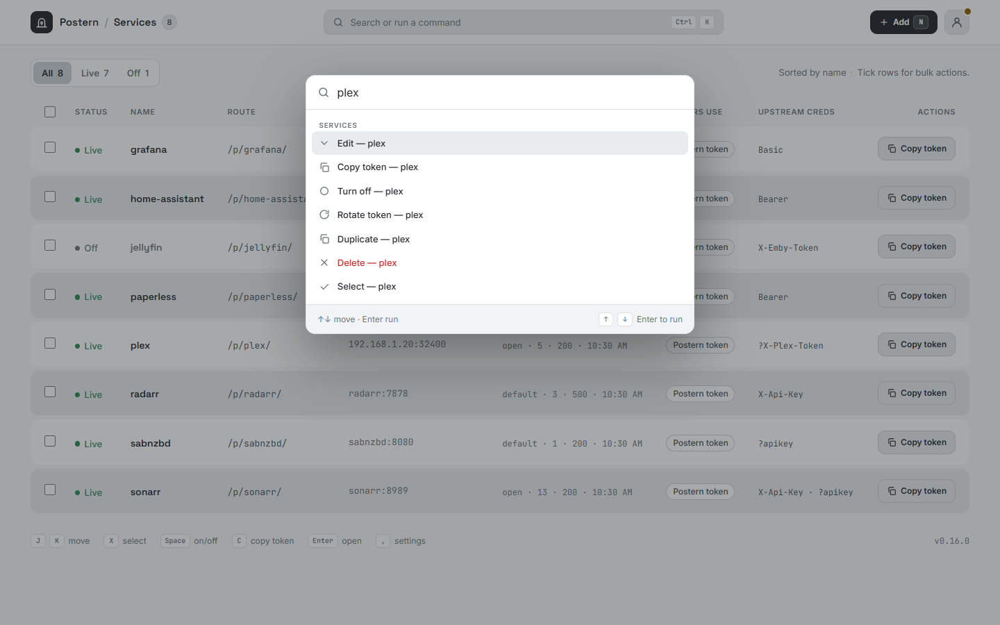

# Postern

A small reverse proxy that puts a front door on private services: callers get a Postern token (or use the service’s own auth shape), while the real upstream credential never leaves this server.

<picture>
  <source media="(prefers-color-scheme: dark)" srcset="docs/screenshots/desktop/dashboard-dark.webp">
  
</picture>

<table>
<tr>
<td width="33%" valign="top">
<picture>
  <source media="(prefers-color-scheme: dark)" srcset="docs/screenshots/desktop/edit-access-scope-dark.webp">
  
</picture>
<br><sub>Several tokens per service, each limited to the methods and paths you choose</sub>
</td>
<td width="33%" valign="top">
<picture>
  <source media="(prefers-color-scheme: dark)" srcset="docs/screenshots/desktop/edit-requests-dark.webp">
  
</picture>
<br><sub>A request log per service, with refusals and their reasons</sub>
</td>
<td width="33%" valign="top">
<picture>
  <source media="(prefers-color-scheme: dark)" srcset="docs/screenshots/desktop/palette-search-dark.webp">
  
</picture>
<br><sub>A command palette for everything, and a layout that works on a phone</sub>
</td>
</tr>
</table>

More screens, light and dark, desktop and phone: the [gallery](docs/gallery.md).

## Layout

| Path | What it is |
|---|---|
| `cmd/postern/` | The server: proxy, admin API, store, sessions |
| `web/` | Admin UI (HTML, CSS, JS). Embedded into the binary |
| `data/` | Local config and design references. Not part of the build |

## Releases

Versions follow [semantic versioning](https://semver.org/). `0.1.0` in [`cmd/postern/version.go`](cmd/postern/version.go) is the baseline already shipped in source. Later versions come from commit messages on `main`.

One release is one git tag, one GitHub Release, and one container image:

| | |
|---|---|
| Git tag | `v1.2.3` |
| GitHub Release | `v1.2.3`, with the changelog |
| Image | `ghcr.io/causefx/postern:1.2.3` (linux/amd64 and linux/arm64), also tagged `1.2` and `latest` |

Every other push to `main` publishes `ghcr.io/causefx/postern:edge` (and `sha-<short>`). Those tags move continuously and are not releases. Tests (`go vet`, `go test -race`) must pass before anything is published. A new GHCR package is private until its visibility is changed in the package settings.

1. Open a pull request whose title is a [Conventional Commit](https://www.conventionalcommits.org/). Squash-merge it so that title is the commit on `main`.
   - `fix:` patch, `0.1.0` → `0.1.1`
   - `feat:` minor, `0.1.0` → `0.2.0`
   - `feat!:` or a `BREAKING CHANGE:` footer bumps the minor while the version is still `0.x`. Put `Release-As: 1.0.0` in the commit footer to cut the first stable major.
   - `docs:`, `chore:`, `refactor:`, `test:`, `ci:` do not cut a release
2. Release Please opens a Release pull request that bumps `cmd/postern/version.go` and `CHANGELOG.md`.
3. Merge that pull request. GitHub creates tag `vX.Y.Z` and the Release, then builds the image with that version and adds the image name to the Release notes.

Do not push `vX.Y.Z` tags by hand. Releases are published only by the Release workflow, so the changelog, tag, binary version and image stay together.

```bash
go build -ldflags "-X main.Version=1.2.3" -o postern ./cmd/postern
```

The running version shows in the startup log, `/admin/api/meta`, the admin header, and the login footer.

## Quick start

```bash
export ADMIN_PASSWORD='choose-a-strong-password'
go run ./cmd/postern
# UI: http://127.0.0.1:8080/admin/
```

Development, one terminal:

```bash
npm install
npm run dev
```

This rebuilds the stylesheet on change, serves the UI from `web/` so HTML and JS edits only need a refresh, and rebuilds and restarts the server when you save a `.go` file. Ctrl+C stops everything. Open `http://127.0.0.1:8080/admin/` and sign in with the password `dev`. The dev script defaults to that password and to listening on loopback only, so a restart keeps you signed in and the known password is not reachable from the network. Set `ADMIN_PASSWORD` or `LISTEN` yourself to change either; `POSTERN_DEV=0` embeds the UI instead.

Docker:

```bash
docker run --rm -p 8080:8080 \
  -e ADMIN_PASSWORD='choose-a-strong-password' \
  -v postern-data:/data \
  ghcr.io/causefx/postern:latest
```

For a real setup, see [docs/operations.md](docs/operations.md): Docker Compose, Caddy, Traefik and nginx examples (in [examples/](examples/)), upgrading, backup and restore, and everything Postern connects to.

## Security

To report a vulnerability, use GitHub's private reporting; see [SECURITY.md](SECURITY.md).

### Admin UI

- Sign-in uses `ADMIN_PASSWORD` (required in production; a random one is generated for the run if unset).
- Sessions are an HMAC cookie derived from `ADMIN_PASSWORD`. Restarting Postern keeps you signed in. Changing the password signs everyone out.
- After 5 failed logins from one IP, further attempts are rejected for 1 minute.
- Optional OpenID Connect sign-in (Pocket ID and similar) sits beside the password. See below.
- Prefer keeping the admin UI off the public internet.

**Separate admin listener (recommended):**

```bash
export LISTEN=:8080                 # public proxy only (/p/...)
export ADMIN_LISTEN=127.0.0.1:8081  # admin UI/API on localhost
```

Point a private reverse proxy or SSH tunnel at `ADMIN_LISTEN`. Leave `ADMIN_LISTEN` unset only when proxy and admin intentionally share one port.

### OpenID Connect

Set `POSTERN_OIDC_ISSUER` and `POSTERN_OIDC_CLIENT_ID` to add a second button on the sign-in page. The admin password still works. Postern uses the authorization code flow with PKCE, checks the ID token (RS256, ES256, or EdDSA), and then issues the same admin session cookie. It does not keep the provider's tokens.

In Pocket ID, add a confidential client, turn on PKCE, and set the callback URL to `https://<admin host>/admin/oidc/callback`. Copy the issuer URL, client ID, and client secret. On the client's Access tab, choose the groups that may sign in. Behind a TLS proxy, set `POSTERN_SECURE=1`.

| Variable | Meaning |
|---|---|
| `POSTERN_OIDC_ISSUER` | Issuer URL from the provider (Pocket ID shows this under the client) |
| `POSTERN_OIDC_CLIENT_ID` | Client ID |
| `POSTERN_OIDC_CLIENT_SECRET` | Client secret. Leave empty only for a public client |
| `POSTERN_OIDC_REDIRECT` | Callback URL, if the public origin is not the host Postern sees |
| `POSTERN_OIDC_LABEL` | Button text. Default `Sign in with SSO` |
| `POSTERN_OIDC_SCOPES` | Default `openid email profile groups` |
| `POSTERN_OIDC_EMAIL` | Optional comma-separated emails that may become admin |
| `POSTERN_OIDC_GROUP` | Optional comma-separated group names. The ID token must include one |

If neither email nor group is set, anyone the provider releases for that client can administer Postern. Use the provider's allowed-groups control, or set one of these, when the client is open to every user.

Settings has an **Admin password** switch once OIDC is configured. Turning it off requires a successful test sign-in in this browser, then Save. Until that save, the password still works. Restarting without the OIDC environment variables turns the password back on, even if the switch was saved off.

### HTTPS and cookies

Session cookies are `HttpOnly` + `SameSite=Lax`. The `Secure` flag follows `POSTERN_SECURE`:

| `POSTERN_SECURE` | Behavior |
|---|---|
| unset | `Secure` only when Postern itself terminates TLS (`r.TLS`). `X-Forwarded-Proto` is **not** trusted. |
| `1` / `true` | Always `Secure` cookies and `https://` public origins. Use this behind a TLS-terminating reverse proxy. |
| `0` / `false` | Force plain HTTP (local/dev only). |

```bash
# Example: Caddy/nginx terminates TLS, Postern listens on HTTP internally
export POSTERN_SECURE=1
```

### Browser protections and embedding

Every admin response (`/admin/...`, never the `/p/...` proxy) carries browser protections: a `Content-Security-Policy` that allows only scripts, styles, fonts and images from Postern itself, `X-Content-Type-Options: nosniff`, `Referrer-Policy: same-origin` and a `Permissions-Policy` that turns off camera, microphone and location. Postern does not send `Strict-Transport-Security`; set it on your reverse proxy, which is the one that knows the site is HTTPS.

By default the admin UI also refuses to be shown inside another page (`frame-ancestors 'none'` and `X-Frame-Options: DENY`). That stops clickjacking, where a hostile page overlays an invisible copy of the admin UI under its own buttons. To use the UI inside a dashboard such as Organizr, Homepage or Heimdall, open **Settings, Embedding** and list the dashboard's address, one per line:

```
https://dash.example.com
http://192.168.1.10:3000
https://*.example.org
```

- Each entry is a scheme, a host and an optional port, with no path. `*.example.org` matches subdomains. `*` on its own allows any site; Settings warns about it, because any website could then overlay the admin UI.
- The setting applies immediately. Empty means nothing may embed Postern. It is stored as `embedOrigins` in the settings file, and a bad entry in a hand-edited file turns embedding off and is named by `postern check`.
- While any site is listed, `X-Frame-Options` is not sent, because it cannot name sites and would block the ones you listed. Only `frame-ancestors` changes.
- Signing in inside a frame needs the session cookie to travel with a cross-site request. When embedding is on and Postern is served over HTTPS, the cookie is `SameSite=None; Secure` for that reason. A dashboard on the same registrable domain as Postern (`dash.example.com` and `postern.example.com`) works over plain HTTP too. Browsers that block third-party cookies (Safari, Firefox with strict tracking protection) will not keep the session in a frame from another domain; embed from the same domain, or open the UI in its own tab.

### Behind a reverse proxy: client addresses

The rate limit, the admin sign-in lockout and the log lines all key on the caller's address. By default that is the address of the connection, and `X-Forwarded-For` and `X-Real-IP` are ignored, because any caller can send them. Behind Caddy, Traefik, nginx or Cloudflare the connection comes from the proxy, so **every caller looks like one client**: they share one rate limit bucket per service, and five failed sign-ins lock everyone out.

Set `POSTERN_TRUSTED_PROXIES` to the address of your proxy and Postern reads the real client from the headers it adds, but only when the connection comes from one of those addresses.

```bash
# One proxy, a range, or several (comma or space separated)
export POSTERN_TRUSTED_PROXIES=172.18.0.2
export POSTERN_TRUSTED_PROXIES=172.18.0.0/16,fd00::/8
# "private" trusts loopback, 10/8, 172.16/12, 192.168/16 and fc00::/7: handy for a proxy on the same host or Docker network
export POSTERN_TRUSTED_PROXIES=private
```

- `X-Forwarded-For` is read from the right, skipping trusted proxies, so entries a caller wrote themselves are never believed. `X-Real-IP` is used when there is no `X-Forwarded-For`. If every address in the chain is a trusted proxy, the leftmost one is the client, which is a machine on the same network as the proxy.
- A request from an address that is not listed is never believed, whatever headers it carries.
- A range that covers every address (`0.0.0.0/0`) is refused, and an entry that is not an address or range stops startup, so a typo cannot silently leave the setting off.
- Your proxy must set or append `X-Forwarded-For` itself and not pass through one from the caller. Caddy, Traefik and nginx's `proxy_set_header X-Forwarded-For $proxy_add_x_forwarded_for` do that.
- In Docker the peer is the proxy container's address on the Docker network (see `docker network inspect`), not `127.0.0.1`.

Postern logs one line when a client first goes over the rate limit in a window (`rate limit: <ip> went over N requests per 1m0s to "<service>"`) and one when an address is locked out of sign-in, so you can see whose traffic is being counted.

### Caller tokens on `/p/...`

- Default access mode requires a Postern-issued caller token. By default that is accepted as `Authorization: Bearer …`, `X-Proxy-Token`, or `?token=`. Per service you can narrow or rename those places (any one enabled place is enough).
- A service can hold up to 8 named caller tokens. Any one of them is enough, and the last one cannot be deleted. Pausing a token refuses that caller with 403 `token paused` until it is resumed. An older file with a single `token` loads as a token named `default`; saves still write that field as the first secret.
- A token can have an **expiry**. Set it from the token's menu in the Access tab (a date, with 7, 30 and 90 day shortcuts), or with `PATCH /admin/api/services/{name}/tokens/{id}` and `{"expiresAt": "2030-01-31T23:59:59Z"}`. An empty string removes it. Once the time passes the token is refused with `401` and `token expired`, in both access modes, and the Recent column and Usage list show `expired`. Rotating a token keeps its expiry. An expiry in the past is refused; pause or delete a token to cut it off now. Tokens with no expiry never expire.
- Each token also shows when it last authenticated, or `Never used`. Refused calls (paused, expired, unknown) do not count.
- A token can have a **scope** that limits what it may do: some HTTP methods (`GET`, `HEAD`, `POST`, `PUT`, `PATCH`, `DELETE`, `OPTIONS`), some paths (prefix or `^` regex, like open paths, matched against the path after `/p/<service>`), or both. Leaving a list empty allows everything in it, and a token with no scope has full access, as before. Set it from the token's menu in the Access tab, or with `PATCH /admin/api/services/{name}/tokens/{id}` and `{"scope": {"methods": ["GET","HEAD"], "paths": [{"match": "prefix", "path": "/api/v3/series"}]}}`; `{"scope": null}` removes it. A request outside the scope is refused with `403` and `token scope` before it reaches the upstream, the Recent column and Usage list show `scope`, and it does not count as use. Rotating a token keeps its scope. Scope applies to every Postern token in both access modes; a real upstream key presented in `access: upstream` has no token and no scope, and open paths skip the token check altogether.
- A proxied path that contains a `.` or `..` segment, plain or percent-encoded, is refused with `400` and `bad path`, so a request cannot step out of an open path or a token scope.
- A switched-off service answers `403` with `service disabled`. An unknown name is `404`.
- Each service and client IP can make `rateLimit` (a setting) proxy requests per minute (default 120, at most 10000), including open paths. Set it to 0 to turn the limit off. The next request over the limit is `429` with an empty body. Admin routes are not counted. The limit is per client address: the connection's, or the real client behind a proxy listed in `POSTERN_TRUSTED_PROXIES` (see above). The Settings drawer saves it immediately. A hand edit of the settings file applies on restart.
- Caller `Cookie` headers are removed before the upstream credential is added.
- Dial and TLS handshake wait 10s, response headers 60s, and idle connections 90s. Streams keep flushing after the headers arrive. An upstream that never sends headers returns `502`.
- Prefer **Bearer** or a dedicated header. Query-string tokens can leak via access logs, `Referer`, and browser history.
- Upstream credentials are multi-slot: a service can use a **request header**, a **URL parameter**, and/or **Authorization** (Bearer or Basic) at once. Postern injects every enabled slot on outbound requests.
- `access: upstream` accepts a matching value in **any one** of those places — the Postern token or the real secret for that slot (by design). Anyone who knows a real upstream key can call Postern in that mode.

### Open paths

Per service you can list **open paths** that skip the caller token check (useful for health checks or public webhooks). Postern still injects the stored upstream credential.

- **Prefix** — matches the start of the proxied path (e.g. `/health` matches `/health` and `/health/ready`). Cannot be `/` alone.
- **Regex** — must start with `^`. Go regexp against the proxied path (e.g. `^/webhooks/[^/]+$`). An unanchored pattern is rejected.

Open paths are reachable by anyone who can hit the proxy port. Keep the list short and specific.

### Data file

Postern keeps its state in a few files in one directory (`data/` by default, `/data` in Docker):

| File | Holds | Secrets |
|---|---|---|
| `postern-data.json` (`POSTERN_DATA`) | services: upstream credentials and caller tokens | **yes** (encrypted when a key is set) |
| `postern-settings.json` (`POSTERN_SETTINGS`) | `activityLimit`, `rateLimit`, `auditLimit`, `passwordLogin` | no |
| `postern-data.json.audit` | admin changes | no |
| `postern-data.json.activity` | recent requests | no |
| `postern-data.json.usage` | when each token last authenticated | no |

Treat the data file like a secrets store; back it up privately.

Service config (including upstream secrets and Postern tokens) lives in `POSTERN_DATA` (default `data/postern-data.json`, or `/data/postern-data.json` in Docker). It holds services only.

Settings live in their own plain JSON file, `postern-settings.json`, beside the data file (set `POSTERN_SETTINGS` to put it elsewhere). It is created with the defaults on first start and is safe to edit by hand; edits apply on restart. Missing keys take their defaults, and a number outside its range is pulled back into range and the file rewritten. A settings file that is not valid JSON stops startup with an error that names it, and is left as written.

```json
{ "activityLimit": 20, "rateLimit": 120, "auditLimit": 100, "passwordLogin": true }
```

Earlier versions kept these settings inside the data file. On first start the new version copies that block into `postern-settings.json`, then rewrites the data file without it. Nothing needs doing. If a settings file already exists it wins and the old block is dropped. To go back to an older version, copy the values from `postern-settings.json` into a `settings` block in the data file, or accept the defaults.

Admin changes are appended beside that file as `POSTERN_DATA.audit` (create, update, enable, rotate, token add, token revoke, duplicate, delete, settings). Lines do not include secrets or query strings. The Settings activity list keeps the newest `auditLimit` lines (a setting) (default 100, at most 5000). At about 1 MB the current file is renamed to `.audit.1` and a new one starts.

When each token last authenticated is kept beside the data file as `POSTERN_DATA.usage`, so the data file is not rewritten on every request. It is flushed at most every 30 seconds, so a crash can lose the last half minute of "last used". It holds token IDs and times only, no secrets. Deleting that file just resets every token to `Never used`.

Recent proxy requests (the Recent column and the Usage list) are kept beside the data file as `POSTERN_DATA.activity`. The Recent column names the caller token on the latest request (`open`, `rejected`, `off`, `limited`, or `upstream` when it was not a token). A paused token keeps its name and is marked paused. How many each service keeps is `activityLimit` in the settings file (default 20, at most 1000). Paths are stored with query secrets redacted. Deleting a service removes its entries. The Settings drawer saves the limit immediately and trims the log.

`GET /healthz` on the proxy listener and the admin listener returns `ok` with no authentication and does not call an upstream.

Check the data file and the settings file without starting the server:

```bash
POSTERN_DATA=data/postern-data.json go run ./cmd/postern check
```

Problems go to stderr and the command exits 1. Valid files print `ok` and exit 0. It never creates or changes a file.

### Encryption at rest

The data file holds your upstream credentials and caller tokens. Give Postern a key and it stores that file encrypted: AES-256-GCM, with the key derived from your passphrase by PBKDF2-HMAC-SHA256 (600,000 iterations, random salt). Settings and the audit, activity and usage files hold no secrets and stay plain.

```bash
openssl rand -base64 32 > postern.key        # a random key is best; any passphrase works
export POSTERN_KEY_FILE=$PWD/postern.key     # or POSTERN_KEY='...'
go run ./cmd/postern
```

Prefer `POSTERN_KEY_FILE`: environment variables show up in `docker inspect` and `/proc`. Set only one of the two. Docker or Compose with a secret:

```yaml
services:
  postern:
    image: ghcr.io/causefx/postern:latest
    environment:
      ADMIN_PASSWORD: choose-a-strong-password
      POSTERN_KEY_FILE: /run/secrets/postern_key
    secrets: [postern_key]
    volumes: [postern-data:/data]
secrets:
  postern_key:
    file: ./postern.key
volumes:
  postern-data:
```

What happens at start-up:

| Data file | Key | Result |
|---|---|---|
| none | none | plain file on the first save, as before. The log says it is not encrypted |
| none | set | encrypted from the first save |
| plain | none | used as is |
| plain | set | read, then **encrypted in place immediately**. No plaintext backup is kept |
| encrypted | right key | decrypted in memory only. Every save is sealed again |
| encrypted | wrong key | refuses to start. Nothing is written |
| encrypted | none | refuses to start. Nothing is written |

An encrypted file is never replaced by an empty one. Each save is read back and checked before it replaces the old file. The Settings drawer shows whether the data file is encrypted, and `/admin/api/meta` reports `encrypted`.

**Back up first, and keep the key somewhere else.** If you lose the key, the secrets cannot be recovered. Restore a backup or add the services again. A backup of the data file is useless without the key, and a copy of the key is useless without the file.

These commands rewrite the data file, so **stop the server first**:

```bash
# Change the key
POSTERN_KEY_FILE=old.key POSTERN_NEW_KEY_FILE=new.key postern rekey
# then start with POSTERN_KEY_FILE=new.key

# Turn encryption off
POSTERN_KEY_FILE=old.key postern decrypt
# then unset POSTERN_KEY and POSTERN_KEY_FILE, or the next start encrypts it again
```

`postern check` also reads an encrypted file: with the key it checks the contents, without it only that the envelope is intact.

This protects the file at rest: copies, backups, disk images, a leaked volume. It does not protect a running server, where secrets and the key are in memory, and it does not help against someone who has both the file and the key. A signed-in admin can still see caller tokens in the UI, as before. Versions from before encryption cannot read an encrypted file; run `decrypt` before going back.

### Export and import

**Settings → Backup** copies your services out as one JSON file and reads them back in. Use it to back up, to move to another instance, or to keep the shape of your setup in git.

**Export config** has two modes:

- **Redacted** has no secrets and is safe to commit or share. Upstream keys are written as empty strings (`"secret": ""`) and caller tokens are listed by name only.
- **Full backup** includes every upstream key and every caller token in plain text, so it is as sensitive as an unencrypted data file. You must tick a box to build it, and each one is written to the admin log. It is not encrypted by Postern. If you want an encrypted backup, copy the data file itself while a `POSTERN_KEY` is set.

The file holds services only: name, URL, upstream auth, caller gate, open paths and caller tokens (with their scope, pause and expiry). Settings and the log files are not included.

```json
{
  "version": 1,
  "exported": "2026-11-13T16:11:00Z",
  "redacted": true,
  "services": [
    {
      "name": "sonarr",
      "url": "https://sonarr.example.com",
      "enabled": true,
      "access": "postern",
      "auth": { "header": { "name": "X-Api-Key", "secret": "" } },
      "openPaths": [{ "match": "prefix", "path": "/ping" }],
      "tokens": [{ "name": "default" }, { "name": "phone", "scope": { "methods": ["GET"] } }]
    }
  ]
}
```

**Import config** reads a file of either kind. Postern first checks it with a dry run and lists what it would do for each service: **create**, **overwrite**, **skip** (the name is taken) or **error**. Nothing changes until you press Import, and nothing is written unless every service passes. Misspelt field names are errors too, so a typo cannot silently drop a setting.

- A service whose name already exists is skipped unless you turn on **Overwrite services with the same name**.
- A **redacted** file has no upstream keys, so a new service that needs one is an error until you add the key to the file. When you overwrite an existing service from a redacted file, it keeps the key it has.
- Caller tokens in a redacted file are matched by name. A token with the same name on the service being overwritten keeps its secret, so callers keep working. Any other token is created with a new secret, and tokens missing from the file are removed. A full backup brings its own secrets and token IDs back.
- A token secret written in a file must be at least 16 characters. Leave it out and Postern makes one.

The API is `POST /admin/api/export` (`{"mode":"redacted"}` or `{"mode":"full","confirm":true}`) and `POST /admin/api/import` (`{"config": <file>, "overwrite": false, "dryRun": true}`). Both need an admin session and the `X-Postern-Admin` header.

## Update checks

Postern tells you when a newer release exists. About a minute after start, and then once a day, the server asks the public GitHub Releases API for the latest releases and compares them with its own version. The only thing it sends is a plain `GET` with the user agent `postern-update-check`: no instance data, no telemetry.

When you are behind, a **vX.Y.Z available** pill appears in the header. It opens an Updates dialog with the release notes for **every** version between yours and the latest (the newest 20, with a link to the rest). The Settings drawer and the command palette ("Check for updates") open the same dialog, and **Check now** runs a check on demand (at most one every 30 seconds).

Postern only reports. It never downloads or replaces itself. The dialog says what to run: in a container, `docker compose pull && docker compose up -d`; otherwise, download the new binary and restart. Development builds (`dev` or any non-release version) skip the check. A failed check, for example with no internet access, shows a message in the dialog and never affects the proxy.

Set `POSTERN_UPDATE_CHECK=off` to turn it off: no request is ever made, and the UI says checks are off.

## Environment

| Variable | Default | Meaning |
|---|---|---|
| `LISTEN` | `:8080` | Proxy listen address (`/p/...`) |
| `ADMIN_LISTEN` | _(empty)_ | If set, admin UI/API bind here only |
| `ADMIN_PASSWORD` | _(generated)_ | Admin sign-in password |
| `POSTERN_DATA` | `data/postern-data.json` | JSON store path (services) |
| `POSTERN_SETTINGS` | `postern-settings.json` beside the data file | Settings file path |
| `POSTERN_KEY` | _(off)_ | Passphrase that encrypts the data file. Prefer `POSTERN_KEY_FILE` |
| `POSTERN_KEY_FILE` | _(off)_ | Path to a file holding that passphrase. Not with `POSTERN_KEY` |
| `POSTERN_NEW_KEY`, `POSTERN_NEW_KEY_FILE` | _(off)_ | The new key, for `postern rekey` only |
| `POSTERN_UPDATE_CHECK` | _(on)_ | `off` stops the daily GitHub release check. See Update checks |
| `POSTERN_CONTAINER` | _(auto)_ | Set by the image. Tells the update dialog to suggest `docker pull` |
| `POSTERN_SECURE` | _(auto)_ | Cookie / origin HTTPS mode (see above) |
| `POSTERN_TRUSTED_PROXIES` | _(none)_ | Proxy addresses, CIDR ranges or `private` whose `X-Forwarded-For` / `X-Real-IP` is believed. See Behind a reverse proxy |
| `POSTERN_SHUTDOWN_TIMEOUT` | `8s` | How long requests in progress get to finish after SIGTERM or Ctrl+C, as a Go duration such as `20s`. Keep it under your container runtime's stop timeout (Docker waits 10s) |
| `POSTERN_DEV` | _(off)_ | Serve UI from `./web` on disk (no rebuild for JS/HTML/CSS). Run from repo root. `npm run dev` sets it for you. |
| `POSTERN_OIDC_ISSUER` | _(off)_ | OpenID Connect issuer. Also set `POSTERN_OIDC_CLIENT_ID`. See above |

## License

Postern is **source-available** under the [PolyForm Shield License 1.0.0](LICENSE), not an open-source license. In plain terms:

- You can use it, run it for yourself or your company, read it, change it and share your changes, for free.
- You cannot use it to provide a product or service that competes with Postern. That covers selling it, selling a modified version, or offering it as a hosted service, and it applies even if you give the competing product away.
- The license text is the only authority. This summary is not legal advice and does not change it.

Contributions are welcome under a simple contributor agreement; see [CONTRIBUTING.md](CONTRIBUTING.md).

If you find Postern useful, donations and sponsorships are what keep it going.
